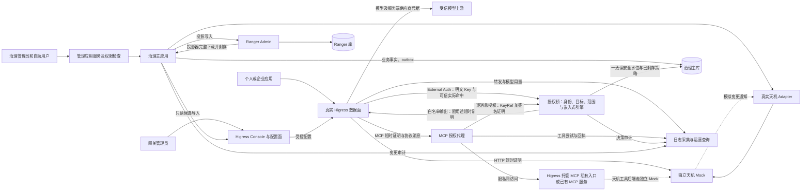
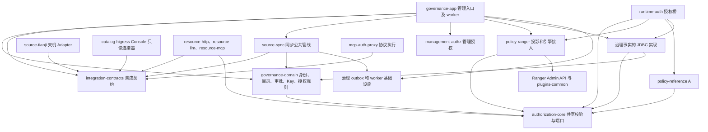
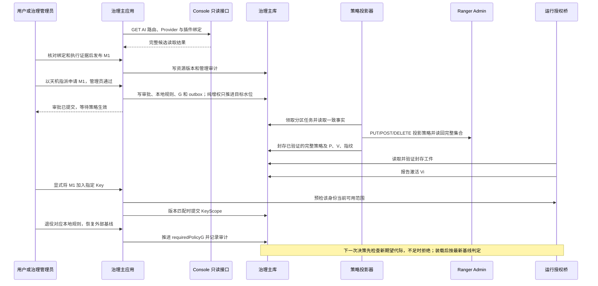
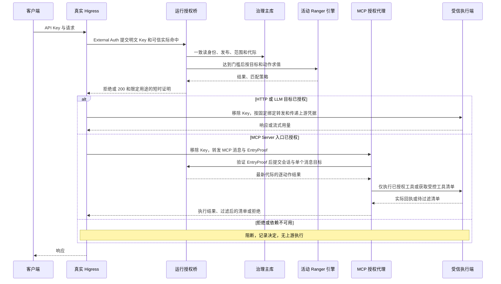
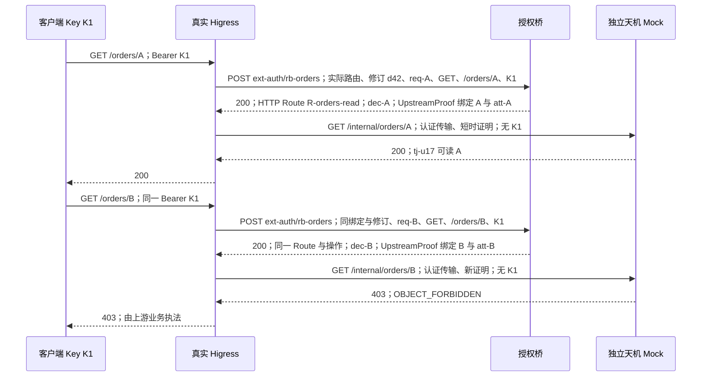
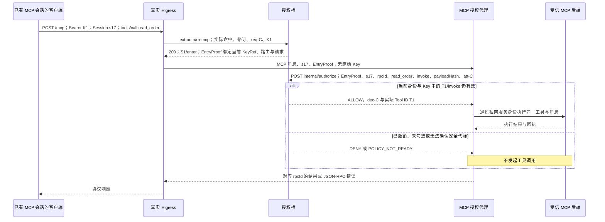

# 基于 Ranger 与 Higress 的治理平台架构设计

**评审稿 1.1 · 2026-11-23（Asia/Shanghai）**

## 1. 范围与架构决定

本设计落实根目录治理方案 v1.6，覆盖来源接入、目录、审批、本地授权、Key、真实网关执行和用量审计。首期天机侧的认证、身份与权限同步、资源标识映射输入、通知及纳入调用链的天机业务接口均由**独立天机 Mock** 提供。基线要求治理主应用、天机 Adapter、网关授权桥、必要的协议执行组件和 Higress 均为真实实现。在目标环境取得天机接口前，Mock 契约只作为开发夹具。

| 编号 | 设计决定 | 实施前有待确认的条件 |
|---|---|---|
| D1 | 自有 Java 模块化单体作为治理主应用，采用标准 Spring Boot 3.5.x、Java 17、Maven、Spring MVC、显式 JDBC 事务、PostgreSQL 17.x；后台复用现有前端技术栈接入管理页面。 | 项目尚无已确认的企业 starter。第一阶段锁定 Boot/JDK/驱动和 Ranger 依赖的可支持补丁、组织认证入口、现有前端栈及运维数据库基线。 |
| D2 | B1 是共享授权引擎的技术验证基线，Ranger Admin 和插件持有派生策略，治理事实留在本地。先以 A 固定规则方案打通共用链路与可部署基线，完成后可作为语义对照和受控回退。 | B1 上线需通过 §9 的正确性、净收益以及业务拒绝窗口门槛。 |
| D3 | 真实 Higress 是统一入口及转发执行点；独立授权桥与主应用共用代码模块，承担运行时校验。MCP 有逐消息校验的授权代理路径；跨模型回退首期默认关闭。 | 确认真实镜像、配置透传、插件顺序、路由信任链、模型实际出站绑定及 MCP 两种后端模式。 |
| D4 | 治理后台通过只读 Console 连接导入；网关管理员在独立权限域配置网关。主应用数据库、Ranger Admin 数据库、网关配置各自拥有写入者。 | 确认 Console 权限粒度；需要时部署精确方法/路径白名单代理。 |
| D5 | B1 使用完整策略快照。可证明的纯增权允许旧代际继续服务，其余影响策略的变更立即提高平台分区安全水位。仅改 Key、身份或发布状态时即时走事实硬校验。 | 撤权或混合更新对同平台无关流量的拒绝窗口由业务方确认；不达标时优先采用直接授权方案 A，而非降低撤权约束。见 §4.3、§9。 |
| D6 | 明文 Key 仅走客户端 → Higress → 授权桥。通过授权后，Higress 经白名单传递由桥签发、限定受众及请求的短时证明。管理端由统一服务端授权点校验操作和对象范围。 | 网关信任链、签发/验签、管理职权归属及既有登录系统需在上线前收口。见 §3.3、§5.3–§5.4。 |

选择标准 Spring Boot 的依据是：主应用需要的是业务事务、模块装配和两个运行入口，模块内持有治理事实；Ranger 依赖限在授权实现与投影器，HiMarket 的 Product、Consumer、Subscription 与本项目的身份授权和 KeyScope 模型不同。已见 HiMarket `HiMarketApplication` 使用标准 Spring Boot，父 POM 对应 Boot 3.2.11、Java 17；本设计单独选择 Boot 3.5.x，保留标准装配方式。数据库、Java/框架大版本及部署切分均为评审假设。 [Spring Boot 装配文档](https://docs.spring.io/spring-boot/3.5/reference/using/using-the-springbootapplication-annotation.html) · [HiMarket v0.8.2 父 POM](https://github.com/higress-group/himarket/blob/v0.8.2/pom.xml) · [架构底座本地调研](./治理控制面开源底座架构适配调研.md)

首期包含三类资源及角色或组织身份的治理、模型审批、LLM/MCP 用量、HTTP 审计和软额度。企业应用使用独立账号。公司属性仅供展示和查询，组织或角色层级不自动传递权限。账单结算、复杂条件编辑器及通用硬配额留待后续建设。本文的上游行为依据固定版本源码和官方资料。所有版本组合、运行行为和容量结论均待实施阶段验证。

## 2. 系统上下文、部署与代码组织

管理入口部署一个模块化应用，异步任务在相同代码的工作进程配置中运行，使用数据库抢占、有期限的任务所有权及提交围栏。同一授权分区只派发给一个任务持有者，换主后重新从权威快照对账。运行授权桥独立部署、独立扩缩容，用最小权限读主库事实及封存策略，嵌入 Ranger 或 A。MCP 授权代理是流式私网执行进程，独立于授权桥的短请求线程池。Ranger Admin 的应用访问由投影器负责写入、完整下载和校验，运维人员经独立入口只读诊断。所有入口使用部署网络策略和服务身份，受保护上游仅接受指定网关或授权代理。天机 Mock 的同步凭据、运行证明、Console 凭据、供应商凭据和客户端 Key 各有使用边界。

箭头表示代码依赖，启动入口负责装配实现。模块名是建议的 Maven 模块或包边界，`authorization-core` 与 `integration-contracts` 放领域可消费的类型和端口，具体实现不得反向成为领域依赖。管理端与运行端使用同一份目标、版本、硬校验及权限接口；管理查询通过运行桥的内部预览接口获得当前结果，写入时核对版本。前端通过管理 API 读取发布、审批、Key、授权传播及审计信息；运行端不加载 Console 或天机客户端。

| 层 | 持有的状态及生命周期 | 归属 |
|---|---|---|
| 平台公共管线 | 来源连接注册、调度/重试/去重/快照屏障、业务事务、outbox、幂等和版本契约、错误及审计模型、决策门槛。 | 主应用定义契约并持久化；授权桥执行读路径；A/B 共用。 |
| 通用策略引擎 | ServiceDef、策略集合、主体资源动作匹配、priority 求值、活动引擎及其释放。策略投影和完整代际校验由本地 `policy-ranger` 管理。 | Ranger 处理通用求值及引擎内部状态；治理平台拥有代际和失效规则。 |
| 业务模块 | 账号与指派、目录及发布、外部基线/本地规则、申请审批、Key、软额度和管理审计。 | 主应用分别拥有业务状态机；通过应用服务修改，各模块只写本域数据。 |
| 来源与网关连接器 | 来源协议、DTO、分页、认证会话及外部标识转换。游标提交、状态持久化、资源发布权限属于公共管线或业务模块。 | 天机 Adapter 连接独立 Mock；Higress 连接器只读取 Console；各自持有短生命周期连接状态。 |
| 协议资源与执行适配 | `ResourceHandler` 定义资源粒度、动作和发布校验，`ProtocolTargetResolver` 将可信网关上下文转换为稳定目标。执行点拥有连接、消息上下文、实际尝试及回执。 | HTTP、LLM、MCP 各自实现转换；Higress 和必要代理执行结果；共同授权桥判定。 |

**扩展落点。** 第二来源 B 仅以组织授权时，注册新的 `SourceAdapter`，映射 `b:D8` 的成员与模型授权；同名 `R17` 和既有账号不会自动合并或继承。第二个 MCP Server／Tool 复用已有 Handler、动作、Resolver 和引擎，增加映射及发布记录。新增同类资源 HTTP Route 只增加匹配绑定和登记；新增资源类型且可用既有扁平业务主键表示时，增加 Handler 和新的类型/动作声明，必要时更新 ServiceDef 并生成新代际。新增协议如 gRPC 时，在能取得实际 Service/Method 的执行点新增 Resolver、执行绑定和回执映射；同一业务目标可沿用已有资源和动作，新增动作须经过目录、KeyScope、投影和错误语义的兼容评审。协议、连接器、资源定义均不重写策略合并或刷新规则。Kafka 的 `configure/authorize/close` 与 HDFS 的 `start/checkPermission/stop` 对同一 `RangerBasePlugin` 的复用提供代码依据，首期的 HTTP 与 MCP/LLM 复用仍需验收。 [Ranger Kafka Authorizer](https://github.com/apache/ranger/blob/release-ranger-2.7.0/plugin-kafka/src/main/java/org/apache/ranger/authorization/kafka/authorizer/RangerKafkaAuthorizer.java) · [Ranger HDFS Authorizer](https://github.com/apache/ranger/blob/release-ranger-2.7.0/hdfs-agent/src/main/java/org/apache/ranger/authorization/hadoop/RangerHdfsAuthorizer.java)

### 2.1 公共同步管线的交接与恢复

`governance-app` 装配 `SourceAdapter` Bean，`source-sync` 按 `adapterType` 注册并拒绝冲突；`SourceConnection` 选定来源实例、平台、授权范围、凭据引用和映射版本。Adapter 必须提供认证、取页或增量、外部稳定 ID 与修订的归一化、快照覆盖证明及来源错误映射。声明不支持的能力。Webhook 可选，只触发取数。项目统一执行以下路径：

1. 定时、手动或通知创建 `SyncRun`。worker 按来源及同步范围领取任务，递增持有令牌。固定本次 `startCheckpoint`、`snapshotId` 与 `mappingVersion`。远程取数在数据库事务之外。
2. 每页以 `runId + pagePosition` 幂等暂存规范记录、页面校验摘要和 `nextPageToken`，携带持有令牌提交。相同页重试可继续，内容冲突中止对账。`nextPageToken` 只用于恢复同一次取数，生效 `committedCheckpoint` 不随页面前进。完整快照要求范围、快照标识、终页及增量交接点可验证。否则不据缺失记录删除。增量要求来源游标连续，旧修订不覆盖新值或 tombstone。
3. 在提交事务中核对持有令牌、起始生效游标和映射版本，应用身份及基线变化、保留本地禁用/覆盖、记录隔离，更新 `committedCheckpoint`、`G`、相应策略代际、审计与 outbox。页面暂存对授权不可见。相同修订的无变化重放可推进确认游标但不产生新的策略代际。游标冲突重新读取起点；源条件无法安全转换则按 §3.1 隔离。
4. 节点失联，租约到期由另一 worker 领取新令牌，验证暂存页后续跑。过期页令牌、已失效快照或映射版本变化，放弃本轮暂存，从已提交游标或新全量重读。旧 worker 可完成在途网络读取，其写暂存及提交一律被拒绝。发布失败后的 outbox 重放使用同一个 `eventId`，不倒退已提交的来源游标。

| 来源 | 完整同步与失败路径 | 新 Adapter 的工作边界 |
|---|---|---|
| 天机 Mock（角色型） | 从无 checkpoint 开始取快照 `TJ-S42`，所有页固定在 `r42`，将 `tj-u17`、`R17`、指派和订单查询外部权限编码为治理记录；全页齐全才提交 `r42`。模拟通知触发从 `r42` 拉撤掉指派的 `r43`，提交后 Key 即时被身份门槛拒绝。若第 2 页超时，接管者仅从已暂存位置继续，旧外部状态在完整提交前保持。 | 实现 Mock 登录交换、带快照分页和增量适配、角色/用户/外部资源映射；若验收有通知再实现验签。 |
| 第二来源 B（仅组织、示例全量） | 获得覆盖组织与权限的版本化清单 `B-S8`，将账号和 `b:D8` 成员关系、组织到模型的授权转换为规范记录，不生成角色。下一次完整清单 `B-S9` 缺少成员 B7 后才撤销成员；若源无法提供完整性证据或快照发生漂移，保留上次提交并报错。 | 实现组织源认证和分页，提供快照覆盖证明、组织身份与资源映射；不声明增量则公共管线不期待连续事件。 |

两个来源共用领取、暂存表、快照生效屏障、游标事务、冲突恢复、审计、幂等、代际分类和投影；新增 Adapter 只交付协议、映射、能力声明及夹具。长期维护与成熟组件取舍见 §7.1。

## 3. 治理事实、状态机与接口

### 3.1 核心实体与唯一业务写入者

| 实体 / 主键 | 字段与约束 | 写入者与生命周期 |
|---|---|---|
| `SourceConnection`、`SyncRun`、`SyncPage` | `sourceId/platformId/adapterType/credentialRef/mappingVersion/committedCheckpoint`；`runId/startCheckpoint/snapshotId/leaseToken`；按 `runId/pagePosition` 暂存 `digest/nextPageToken` 和规范记录。来源记录键为 `(sourceId, objectType, externalId)`。 | 来源接入模块配置连接；`source-sync` 持有任务、暂存页及游标提交。Adapter 输出记录及完整性证据。 |
| `Account`、`ExternalAccountLink`、`PlatformEligibility` | `accountId`、`person/app`、责任人、状态；外联按 `(platformId, sourceId, externalSubjectId)` 唯一。 | 账号模块开户、核实关联、管理资格；同步仅更新授权的来源事实。 |
| `Role`、`Assignment`、`OrgMembership` | 角色 `(platformId, roleId)`；指派 `assignmentId/accountId/roleId` 及来源状态、本地禁用、有效期和身份版本；组织成员带平台和有效期。 | 同步写外部状态；身份管理写本地禁用/解除，两列独立。以 tombstone 保留撤销历史；已失效指派重新授予的连续性无法确认时生成新指派。 |
| `CatalogCandidate`、`Resource`、`TargetBinding` | 稳定 `resourceId/type/parentId`；`gatewayId/observedRouteId/routeBindingId/protocol/selector/upstreamRef`；`deploymentRevision/bindingRevision/digest/resourceVersion`、责任人、验证记录和发布状态。 | 目录模块导入候选，管理员显式发布/暂停/下线；网关发布流程产生部署修订及实际路由证据，目录只读核对。 |
| `BaselineGrant`、`LocalRule`、`MappingBlock` | `platformId/subjectKind/subjectId/resourceId/action/effect`，生效区间、可选角色/组织限制；来源 revision 或本地操作者及理由；`MappingBlock` 保存不能安全转换的已知影响范围。 | 同步写外部基线与隔离状态；授权管理写本地规则；审批仅经本地授权服务写入带审批引用的独立规则。 |
| `ModelApplication` | `applicationId/accountId/platformId/assignmentId?/modelId/reason/status/reviewer` 及版本；通过时一项审批对应一项规则。 | 模型审批模块，待审到通过、拒绝或撤回；撤销已发规则通过授权模块留痕。 |
| `ApiKey`、`KeyScope` | `keyId/prefix/secretDigest/accountId/platformId/assignmentId?/state/expiresAt/keyVersion`；`scopeVersion` 与多条 `(resourceId, action)`，同一 Key 的范围整体替换。 | Key 模块签发、改范围、轮换及不可逆吊销；身份或发布撤销时保留原勾选以便审计。 |
| `PolicyOutbox`、`PolicyManifest`、`PolicyLink` | `G/desiredPolicyG/requiredPolicyG/servingPolicyG/changeClass`、投影代际 `P`、服务版本 `V`、完整指纹、 `ruleId ↔ policyId`、构建状态与故障。 | 业务事务分类并推进目标与安全水位，写 outbox；投影器写完整清单和 Ranger 策略；授权实例发布已激活的 `Vi`。 |
| `ManagementAudit`、`DecisionEvent`、`AttemptEvent`、`UsageEvent`、`SoftLimit` | `eventId/requestId/decisionId/attemptId` 与发生时的身份、目标、版本；额度含主体、周期和阈值。 | 业务事务写管理审计；授权桥、执行组件各自生产事实，日志/用量消费幂等写入并聚合；运营模块管理软额度。 |

资源状态为 `CANDIDATE → PUBLISHED → SUSPENDED → PUBLISHED`，已发布或已暂停均可转 `RETIRED`，下线终止原发布生命周期。Console 导入结果按网关、来源对象与目标去重，完整快照和受控探测承担绑定核验。部分分页、超时或认证失败保留上次完整结果及失败原因。确认绑定消失、漂移或鉴权失效后暂停受影响资源；暂停或下线后原 Key 的该资源不可调用。更换为不同业务能力时必须新建资源 ID，已有授权和勾选不迁移。网关管理员先隔离待变更入口，再核验并开放；运行时也校验受保护路由配置标识，以覆盖两次刷新之间的偏离。

来源同步先暂存全量或增量。全量必须验证分页覆盖、同一快照标识、范围及完整性才切换生效并处理缺失；增量校验连续游标并按来源记录修订去重，缺口触发对账。重复消息不推进版本，乱序旧记录不覆盖 tombstone。隔离尽量限定到可确认的主体和资源，影响边界无法推断则关闭对应来源授权分区；本地允许也不能越过隔离门槛。源不可达保留已提交事实并告警，符合 v1.6 的本地记录判定语义；显式禁用和已确认撤权不等待来源恢复。角色型来源要求 Key 绑定某个指派，组织型无角色来源按平台账号和当前有效成员关系判定。企业应用用自己的账号、授权及 Key，不从责任人继承。

签发与范围变更按当前有效权限、发布状态重新校验每个选项，写入前核对预检使用的身份、规则和目录版本，版本中途变化则重算或返回冲突。范围保存具体资源和动作，服务级批选、Provider 选模型、MCP Server 批选工具均取当时的子项快照。MCP 工具选择可以显式附带 Server `enter` 和相应 `discover`。高熵 Key 只在签发或轮换成功时显示明文，持久化摘要与公开前缀；轮换原子更换摘要并沿用范围，旧秘密失效。写命令重试返回已创建记录及状态，不再次返回明文；响应丢失时走显式轮换。吊销、过期、禁用与目录暂停由运行时硬检查即时判定。绑定身份不可被网页切换或 Key 修改更改。

### 3.2 关键接口草案

以下路径和结构属于本项目契约。管理接口在应用服务校验会话、操作权限及对象范围。写命令使用幂等键及 `expectedVersion`，幂等键相同而请求内容不同返回 `409`，并发版本变化返回 `409 VERSION_CONFLICT`，非法范围或字段返回 `422`。影响策略时返回 `changeClass/desiredPolicyG/requiredPolicyG`，查询传播状态包括仍服务的实例代际及中断范围。

| 调用与接口 | 关键输入 / 输出 | 异常及处理 |
|---|---|---|
| 同步器 → `SourceAdapter.pull` / `normalize`，天机登录通过 `exchangeIdentity` | 输入 `sourceId/mode/startCheckpoint/snapshotId/pageToken/mappingVersion`；输出 `snapshotId/sourceRevision/nextPageToken/terminal/coverageProof/finalCheckpoint?` 及规范记录，认证输出外部稳定主体及可验证颁发方。`finalCheckpoint` 由公共管线核验后提交，Webhook 只触发拉取。 | `SOURCE_UNAVAILABLE` 重试；`REVISION_GAP` 触发全量对账；`MAPPING_UNSUPPORTED` 隔离；持有令牌或版本过期返回 `LEASE_LOST` 或 `VERSION_CONFLICT`，不得生效。 |
| 管理员 → `POST /admin/catalog/refresh`、`POST /admin/resources/{id}/publish` 及 `/suspend`、`/retire` | 刷新入参 `gatewayId/kinds`，返回 `syncRunId`；发布提交 `candidateId/bindingRevision/evidenceRef/owner` 并返回 `resourceVersion`。 | `UPSTREAM_READ_FAILED` 保留完整快照；映射冲突 `409 TARGET_AMBIGUOUS`；证据缺失 `422 PUBLICATION_UNVERIFIED`。 |
| 管理员 → `PUT /admin/overrides/{id}`、`POST /admin/assignments/{id}/disable` 及 `/enable` | 平台、主体、目标、动作、`ALLOW/DENY/RESTORE_BASELINE`、期限、原因。支持 `GET /admin/policy-changes/{G}` 查询期望／完成及实例观测。 | 恢复操作退役指定改写记录；独立审批规则仍须单独撤销。非法跨平台范围返回 `403`，投影异常显示 `PENDING` 或 `FAILED`。 |
| 用户及审批员 → `POST /model-applications`、`POST /admin/model-applications/{id}/decision` | 绑定身份、`modelId`、理由、状态及审批结论；通过时同一事务写账号限定规则、审计和 outbox。 | 模型暂停或身份失效时返回 `409`，审批重放不重复授权。 |
| 用户或应用管理员 → `GET /key-options`、`POST /keys`、`PUT /keys/{id}/scope`、`POST /keys/{id}/rotate` 及 `/revoke` | 预览按平台身份；显式 `{resourceId,action}[]`、身份、期限和版本；签发返回 Key 明文一次，更新返回 `keyVersion/scopeVersion`。 | `SCOPE_NOT_ALLOWED`（含资源未发布）返回 `422`；策略尚待生效返回 `503 POLICY_NOT_READY`，避免以旧策略签发。 |
| 审计查阅者 → `GET /admin/audit`、`GET /admin/audit/{eventId}`、`POST /admin/audit/exports` | 过滤 `platformId/accountId/keyId/timeRange/eventKind`，服务端与可查范围求交；导出任务绑定请求者和授权范围。 | 明确指定范围越权时返回 `403 MANAGEMENT_FORBIDDEN`；导出执行及下载均重新校验现有权限。 |
| 控制面 → Console GET；目录模块调用 `ResourceHandler.validateBinding` | 返回规范绑定、候选粒度、路由或插件证据、协议执行要求；只保存脱敏白名单字段。 | 候选无法唯一绑定目标时保持待核验，对应运行目标拒绝。见 §7.3。 |
| Higress → `POST /internal/ext-auth/{routeBindingId}`；MCP 代理 → `POST /internal/authorize`；管理端 → `POST /internal/preview` | 网关从受信上下文提交 `{gatewayId,observedRouteId,deploymentRevision,requestId,method,path}`、明文 Key 和必要协议字段。MCP 代理提交短时 `EntryProof` 与代理服务身份，以及 `{sessionId,jsonRpcId,toolName,action,payloadHash}` 等实际消息字段；预览用服务身份加明确的账号与指派。桥返回 `decisionId/outcome/reason/resourceId/action/versions/policyId?`，放行时按用途签发证明。 | ext-auth 仅 `200` 允许；`400` 无法解析、`401` 凭证无效、`403` 权限或目标拒绝、`413` 受检请求超限、`503` 事实或安全水位未就绪。预览可指明 `GRANT_PENDING`，运行旧代际期间新增授权仍按其实际结果判定。见 §5.3。 |
| 执行组件 → `DecisionEvent` / `AttemptEvent` / `UsageEvent` | `schemaVersion/eventId/requestId/decisionId/attemptId/source/occurredAt/phase` 及事件载荷。 | 重复事件幂等；乱序按尝试归并；无法确认执行或用量标 `UNKNOWN/INCOMPLETE`。 |

### 3.3 管理操作授权

下表给出首期职权划分建议，来源 v1.6 只给出治理管理员、普通用户和应用管理员等概念；细分分工、禁止自批和运维审计人员的授予方式需确认。管理授权不从业务角色、平台 Key 或 Console 写权限推导。`management-authz` 的 `ManagementAuthorizer.check(actor, operation, objectScope)` 由管理应用服务统一调用，Spring Security 6.5 方法授权入口负责约束服务边界。服务端从已认证会话解析主体，从主库读目标对象和委派范围，写操作在同一事务保护作用域检查与更新，变更版本冲突重试。审批到规则写入使用审查通过的限定命令；worker 使用独立服务身份和精确操作许可。列表、导出和按 ID 读取使用同一范围过滤。 [Spring Security 6.5 方法授权](https://docs.spring.io/spring-security/reference/6.5/servlet/authorization/method-security.html)

| 操作 | 建议主体 | 平台和对象范围 | 审计记录 |
|---|---|---|---|
| 刷新候选、发布、暂停、下线 | 指定治理目录管理员；网关管理员另管部署。 | 在已委派的网关与资源范围内操作。跨平台共享资源的发布或全局暂停须取得共享资源管理范围；业务平台管理员可管理其权限范围内的规则。 | 操作者、资源/网关、发布前后状态、绑定修订、核验记录、原因、多平台影响。 |
| 允许、拒绝、恢复基线、禁用指派 | 平台权限管理员。 | 必须拥有目标平台及目标主体范围，规则影响的资源/动作也须可管理；复选或批量逐对象校验。 | 原规则、目标范围、前后值、来源及 `G`，拒绝记录不返回未授权对象信息。 |
| 模型申请与审批 | 用户/应用管理员提交；有该平台和模型范围的审批员裁决，建议禁止自批。 | 提交者只能代表自己或受委派应用和有效指派，审批员必须覆盖该申请的账号、平台和模型。 | 申请方、审查方、范围、决定/理由、审批规则 ID。 |
| 应用 Key 创建、改范围、轮换和吊销 | App 责任人或受委派的应用 Key 管理员。 | 仅管理授权的应用账号及其平台身份和 Key；勾选仍校验该应用当前可用权限。 | 操作者、应用、Key ID、动作、范围/状态变更和版本，无秘密。 |
| 审计与用量查询/导出 | 建议设受委派审计员；主体可查各自 Key 的可见记录。 | 强制平台及账号/应用/Key 范围，列表、详情、导出一致；跨平台查询需逐平台委派。 | 审计员/调用方、过滤器摘要、真实访问范围、导出动作和结果，不记录原始敏感内容。 |

授权拒绝统一返回 `403 MANAGEMENT_FORBIDDEN`，也适用于无权查看的指定对象，防止区分未授权对象是否存在。按明确的平台、对象和应用委派范围实现。实际岗位分配、跨平台授权和自批例外尚未授权，可用隔离的模拟岗位验证；没有明确委派或例外授权时拒绝。生产访问范围及角色分配与既有组织登录系统核实后配置。

## 4. 权限求值与有效版本

### 4.1 同一决定的输入和顺序

1. 校验调用方为受信网关或协议执行点。从该执行点取得可信绑定上下文。校验 Key 摘要、状态和期限，查账号、平台资格、选中的指派及适用组织，拒绝失效。预览用受信服务身份及指定账号与指派代替 Key 输入。
2. 解析实际目标，拒绝缺失、歧义或修订不一致的绑定。检查资源与父级入口的发布状态以及影响本次请求的隔离标记。带 Key 的请求检查其 `KeyScope` 是否包含精确 `(resourceId, action)`。预览复用同一目标和发布检查。
3. 比较权威快照视图的期望策略代际与实例激活代际，满足 §4.3 后求值。先取适用本地规则：同级拒绝优先，存在本地允许即允许；没有本地命中才进入外部基线，同级拒绝优先，缺少有效允许则拒绝。审批放行走同一本地优先级。
4. 每个允许的 `decisionId` 只绑定该身份、资源、动作、配置和尝试上下文。上游应用仍检查数据对象可见性、操作状态及业务约束。允许决策只提供转发许可，执行结果由实际执行点写入。

拒绝原因按检查阶段细分为 `TARGET_UNKNOWN`、`BINDING_DRIFT`、`RESOURCE_INACTIVE`、`KEY_INVALID`、`IDENTITY_INACTIVE`、`MAPPING_BLOCKED`、`SCOPE_MISSING`、`POLICY_NOT_READY`、`LOCAL_DENY`、`BASELINE_DENY`、`NO_MATCH` 和 `DECISION_UNAVAILABLE`。只有明确允许结果可以放行。命中拒绝规则时，经已激活清单关联 `policyId → ruleId/层级`；引擎正常完成且无规则命中时归 `NO_MATCH`，引擎异常、结果为 null 或归因不可靠用 `DECISION_UNAVAILABLE`。客户端错误不暴露账号、规则或资源枚举信息。管理预览可显示外部与本地事实、当前结果和原因，传播中明确显示尚未生效的规则。

### 4.2 B1 策略编码与 A 对照

Ranger 定义自有 `ServiceDef enterprise_access`，每个平台一个 Ranger Service 作首期传播隔离边界；资源仍包含精确 `platform → type → id`。动作按协议定义为 `enter/discover/invoke/http_access/model_invoke`。投影器按每条外部基线或本地规则编码策略，保留来源，使用 `POLICY_PRIORITY_NORMAL=0`、`POLICY_PRIORITY_OVERRIDE=1` 以及原生 `policyItems/denyPolicyItems`。启用所需 deny 支持；禁用自动兜底、规则例外、任意通配、额外标签策略、权限补算和绕过判定的插件链。策略配置与模板由治理部署控制；Ranger Admin UI 可用于受控诊断，运行服务的写权限仅给投影器。 [RangerPolicy 常量与字段](https://github.com/apache/ranger/blob/release-ranger-2.7.0/agents-common/src/main/java/org/apache/ranger/plugin/model/RangerPolicy.java) · [引擎求值实现](https://github.com/apache/ranger/blob/release-ranger-2.7.0/agents-common/src/main/java/org/apache/ranger/plugin/policyengine/RangerPolicyEngineImpl.java) · [官方 priority 测试数据](https://github.com/apache/ranger/blob/release-ranger-2.7.0/agents-common/src/test/resources/policyengine/test_policyengine_priority.json)

首期候选将角色和部门编码成**自有命名空间的组键**，运行桥按已选身份从事实计算本次 `userGroups`，并用权威一致读的时间设置 `accessTime`，Ranger 中无角色关系授权。平台账号作为内部 principal，账号限定角色或组织的条件编码为单一组合组键，避免把多个匹配项当成逻辑与。使用安全编码的组件标识，组合键从已选指派和当前有效成员生成，映射版本纳入清单，Ranger 不从用户库添组。若空集合触发默认角色补算，服务须保持 roles 集合为空且没有任何授权规则使用 Ranger roles，关闭隐式用户存储增强及 `use.rangerGroups`，用跨平台、无角色、同名和组合条件夹具证明未扩张。时间条件首选原生策略 `validitySchedules`，按统一时间及边界语义验证与 A 一致。无法无损表达的限制进入隔离，涉及首期必须支持的语义则触发 B1 退出条件。 [RangerDefaultRequestProcessor](https://github.com/apache/ranger/blob/release-ranger-2.7.0/agents-common/src/main/java/org/apache/ranger/plugin/service/RangerDefaultRequestProcessor.java) · [RangerPluginConfig](https://github.com/apache/ranger/blob/release-ranger-2.7.0/agents-common/src/main/java/org/apache/ranger/authorization/hadoop/config/RangerPluginConfig.java)

HTTP 服务级 `http_access` 授权覆盖当时已发布的该服务子路由，投影器对服务授权做**目标展开**，A 读取同一父子关系。新增路由发布或父子绑定改变时推进相关分区的策略代际并重建展开。具体路由的本地拒绝与服务级本地允许投影到同一精确路由，按同级拒绝优先。HTTP 服务授权可以按目录覆盖新增路由，Key 的具体勾选永不继承。MCP Tool 与 Server 分别授权，模型 Provider 和工具集合的批授只展开当次选择。此处展开保留每条原始规则及优先级，B1 的最终 allow/deny 仍由 Ranger 逐请求计算。KeyScope 始终由治理主库和授权桥处理，每把 Key 的变更无需生成 Ranger 策略。

| 案例 | 预期身份权限 | 最终执行 |
|---|---|---|
| 外部拒绝 T1，本地允许 T1 | 允许，匹配优先级 1 | K1 有 `T1/invoke` 且通过其它门槛时允许 |
| 同时匹配本地账号允许和本地角色拒绝 | 拒绝，同级拒绝优先 | `LOCAL_DENY` |
| 恢复外部基线，剩外部拒绝 | 拒绝，命中优先级 0 | `BASELINE_DENY` |
| 模型审批后已有 K1 仍未勾选 | 允许，优先级 1 | `SCOPE_MISSING` |
| 身份本地禁用、权限缓存仍命中 | 身份硬门槛拒绝 | `IDENTITY_INACTIVE`，同步不会解除 |
| 只授权 T2 的 `discover`，或只授权 `invoke` | 独立按动作求值 | 发现与调用可单独允许；直接调用仍检查 `invoke` |
| 平台 B 同名 R17 或无角色访客 | 仅匹配自己的平台和本次主体键 | 不继承 `tj:R17`；无允许则 `NO_MATCH` |
| 服务级允许 + 具体路由本地拒绝 | 对该路由拒绝 | 同服务其他路由仍可按各自权限和 Scope 放行 |

### 4.3 G → P → V → Vi 的完整性协议

| 水位 | 所有者 | 含义 |
|---|---|---|
| `G`、`desiredPolicyG`、`requiredPolicyG` | 治理主库 | `G` 是分区有序提交号。若投影输入变动，目标 `desiredPolicyG` 推到本次 `G`，由同一事务按限制性分类决定是否提高最低安全水位 `requiredPolicyG`，并写审计/outbox。 |
| `P` | 投影器 | 固定分区、覆盖的 `G`、ServiceDef/模板指纹、完整策略及原规则映射。完整回读通过后将实际 `ServicePolicies` 封存为不可变工件，与已验证清单一并提交。 |
| `V` | Ranger Admin | 某个 Service 的完整策略下载版本。单条 REST 写成功或 `V` 数值递增不能证明 `P` 完整。 |
| `Vi` | 每个授权实例 | 已装载且能求值的 `(platformId,G,P,V,digest,engineConfigVersion)`，由运行桥与活动引擎同一次交换发布。 |

**提交与投影。** 对每个平台的版本记录加事务锁。投影器按平台串行，提交清单前核对任务持有令牌；失联换主后先对账。可合并多个待处理提交到最新一致快照，合并不能降低任何已经提交的安全水位。使用稳定规则键进行幂等增删改；写完后通过 `RangerAdminRESTClient.getServicePoliciesIfUpdated` 完整读取，对照 ServiceDef、允许和拒绝项、期限、默认/附属权限集合及策略映射。只有指纹与完整期望策略一致才封存 `P,V,digest`。首期由治理主库保留至少当前可服务与待激活的完整工件，实例重启可重载已验证版本，无须访问正在被写入的 Ranger Admin。回收前验证仍在服务的代际，按主库大小、恢复和读取压力评估后续存储。空/部分集合、异常读回与外部编辑不能自行成为新快照，紧急维护走暂停分区、换 epoch、重建和核验。

**实例装载。** 关闭 Ranger 原生自动刷新（`policyengine.option.disable.policy.refresher=true`），投影回读关闭增量（`supports.policy.deltas=false`）。授权实例读取已封存工件并校验 epoch、服务定义及指纹，在新插件实例以 `init/setPolicies/getPolicyVersion` 装载并核验，原子交换 `(Vi, plugin)`，在途读者退出后 `cleanup` 旧实例。完整空集合只在明确验证为无许可且以安全方式装载后生效。加载失败保留符合安全水位的旧插件；未达到水位则拒绝。须验证控制装载所用接口、错误传播、空集合及实例生命周期。本地拥有分发、核验、激活和失败处置。 [RangerBasePlugin](https://github.com/apache/ranger/blob/release-ranger-2.7.0/agents-common/src/main/java/org/apache/ranger/plugin/service/RangerBasePlugin.java) · [RangerPolicyEngineOptions](https://github.com/apache/ranger/blob/release-ranger-2.7.0/agents-common/src/main/java/org/apache/ranger/plugin/policyengine/RangerPolicyEngineOptions.java) · [RangerAdminRESTClient](https://github.com/apache/ranger/blob/release-ranger-2.7.0/agents-common/src/main/java/org/apache/ranger/admin/client/RangerAdminRESTClient.java)

**每次放行。** 授权桥在治理主库短时 `REPEATABLE READ` 只读事务中读取身份、Key、范围、绑定、隔离、运行 epoch 及代际。授权线性化点为取得一致快照之时。活动 `Vi` 关联事务内可见的已核验清单，且清单覆盖 `requiredPolicyG`，允许 `Vi` 落后于纯增权的 `desiredPolicyG`。尚未取得安全代际返回 `503 POLICY_NOT_READY`；纯增权等待期仍按当前有效代际判定，管理预览显示“增权待生效”并禁止把未生效的增权加入 Key。决策记录含 `G/desiredPolicyG/requiredPolicyG/P/V/Vi/engineMode/epoch` 与身份、Key、Scope、资源、绑定相关版本。展示已提交、已封存、服务中代际及已全部激活，后者以承接分区流量的实例为准。授权无法确认主库事实时拒绝；备份恢复时建立新 epoch。已提交的撤权约束新判定，已发往上游的在途工作只做追踪，每条长连接新业务消息仍重判。

**同平台无关用户是否受影响。** 初始时天机分区全部使用 `G10`，乙仍有已登记订单查询权。分类由领域事务对投影前后规范规则做保守差异判定，仅当**唯一改变是向已存在的精确目标增加格式受限的 allow 项**、既有规则/deny/条件/主体映射/绑定/模板和有效期都未改，且引擎可证明既有允许不缩减，才标 `GRANT_ONLY`。实现和两引擎回归不能证明时一律走限制性路径。

| 甲的变更和故障 | 默认水位及旧版授权 | 乙及恢复 |
|---|---|---|
| 仅增加甲的模型允许 → `G11` | `desired=11, required=10`，旧引擎对甲沿用旧状态。已带该项 Scope 的调用随实例逐步看到新增许可，推广完成前可能命中旧结果。 | 乙继续按 `G10` 放行。全部实际承接该分区的实例覆盖 `G11` 后，管理端标记该次增权已生效并可凭该新增权限签发或改 Scope；投影失败则重试并告警。 |
| 撤掉甲的策略允许 → `G12` | `desired=required=12` 与治理事实同事务提交。旧代际无法证明不放甲，所有仍旧的实例对该平台策略请求拒绝。仅吊销 Key、禁用指派或暂停资源且投影输入未变时即时按硬门槛拦截，无需升策略水位。 | **乙可能临时失败。** 先把流量引至已安全激活的实例；没有分区感知路由时，由每个实例独立拒绝该分区。其它平台不受此屏障影响。 |
| 同一事务增甲的 M2、撤甲的 M1，或重映射/不确定变更 → `G13` | `desired=required=13`；整个事务按限制性提交。禁用阶段不得临时把增权部分先开放。 | 与撤权相同。连续合并构建的快照须覆盖所有已提交撤权，不得回到 G12 或更早。 |
| 工件核验、分发、装载或 Admin 故障 | 纯增权期间，能从现有引擎或治理库封存快照验证 `required` 的实例继续服务；限制性提交之后任何不达标实例继续关闭。 | 分区观测可区分 `target pending` 与 `safety floor unmet`。重试回读或重建、换主对账、摘流失败实例；不回降水位。超过业务确认的窗口按 §9 执行受控 A 切换或继续保持拒绝。 |

**路线比较与推荐。** 所有写入都升安全水位最容易验证，却把纯增权也变为同平台中断。先预装、后提交可降低限制性更新的停顿，但必须明确即时撤权语义，且需双代际资源和失败协调，首期不将撤权提交推迟到预装完成。按受影响主体或资源设细粒度限制可缩小影响，但共享规则、服务级路由和组织变更会扩大依赖，首期无法轻易证明完整覆盖。推荐先用“严格识别纯增权 + 其余变更平台屏障”，保留 A。A 直接在同一个治理事实快照做固定规则求值，使用相同桥、硬校验和审计，省去 Ranger 投影与激活引入的拒绝窗口。**需业务裁决**该平台级中断是否可接受、最长连续拒绝窗口及降级触发。超过预算或不接受同平台连带中断时首期选 A。紧急撤权不延后，单请求不自动跨引擎回退。

纯增权推广完成以受控流量成员为准。确认当前承接该分区的成员均已达到目标后，记录已发布服务代际 `servingPolicyG`，并要求此后加入该分区流量的实例至少覆盖该代际。该准入要求与安全水位分别核验，以免扩容或滚动重启把已确认的新增授权退回旧结果。部署无法逐分区控制准入时，从整组实例的就绪检查落实该门槛；两种方式均不可用时，不宣告该次推广完成。

## 5. 主流程与真实请求链

### 5.1 管理链示例：审批开通模型，再撤销本地覆盖

如果来源原来显式拒绝 M1，审批通过后优先级 1 的允许在实例激活时覆盖基线拒绝。同步更新外部层时保留该审批规则。管理员撤销该规则使优先级 0 的拒绝重新生效，KeyScope 原记录继续保留。时间或身份失效从对应硬门槛或规则条件即时生效，接口不会要求用户通过重新签发来撤权。

### 5.2 一条真实请求链及三类转发分支

- **共同可信边界。** 按路由配置固定 ext-auth 端点标识和部署修订，用覆盖式 `headers_to_add` 或受控路径元数据传入桥，实际路由首选通过 `allowed_properties` 传入 `route_name`；鉴权使用 ext-auth 的 forward-auth 模式向固定端点发 POST，原 Method/路径来自插件覆盖设置的 `X-Original-Method` 和 `X-Original-URI`，或经验证的等效受信网关属性。在读取身份前丢弃客户端同名内部头、回退标记和内部路由控制头，认证成功后仅注入白名单字段。桥只接受来自授权网关或协议代理的请求，证明绑定网关、路由、身份、用途及请求/尝试，短期有效。受保护路由配置 `failure_mode_allow=false` 与 `status_on_error=503`，确保依赖错误不会放行或被误记为权限拒绝。每次业务操作仍重新读取当前 Key 状态。转发时移除平台 Key，供应商或后端凭据由执行端独立提供。若插件配置无法让授权桥可信区分实际路由，发布保持阻断，待网关配置或本地执行适配完成。 [Higress ext-auth 源码](https://github.com/higress-group/higress/blob/v2.2.6/plugins/wasm-go/extensions/ext-auth/main.go)
- **HTTP。** 比较可信 `routeBindingId`、部署 revision、Method 与实际转发规则；按唯一、预先验证的方法和规范化路径模板映射 Route ID。有路径重写、编码歧义或重路由时，授权绑定必须对应最终业务路由，无法唯一对应则拒绝。下游只接受受信转发并负责对象级约束，网关不替业务系统决定对象权限。
- **LLM。** 限定受支持 API 路径和请求体大小，在转发前解析唯一 `model`，将别名映射到已发布的真实目标 `modelId/provider/upstreamModel`，审计保留请求别名和实际目标。多个模型共用入口地址时，路由与插件配置必须锁定到受授权的目标与请求模型。模型重写、供应商选择、模型缺失默认值均须进入同一绑定核验。同一公开 route 下无法证明实际目标等于批准结果时，拆成固定目标的内部执行绑定，或以受控出站执行点核验并锁定目标；无法锁定时保持该映射未发布。首期默认关跨模型回退。将来启用时，出站执行点对新的 `attemptId` 和实际模型重新运行完整授权，拒绝则不发送；相同模型的已登记上游切换也必须核对实际绑定。返回的用量或模型名用于核对，不能作为转发前的授权证据。流式响应的已发出内容不作回放或重试。
- **MCP。** 基线路由经真实 Higress 入口 `S1/enter` 再到自有代理；代理连接 Higress 托管 MCP 的私有路由或已有服务，统一拦截协议消息。`tools/list` 按 `discover` 与 KeyScope 的批量交集过滤；仅返回已发布且在上游答复出现的工具。页游标关联 Key、Server、授权/目录版本与上游位置，版本变更时要求从首页重读，空页可继续分页且不泄露隐藏工具；处理响应超时或期间发生的版本变化时重新校验或终止响应。`tools/call` 按 `Server+params.name → Tool ID` 检查 `invoke`，直接调用、已记住名字或已有会话都经过同一门槛。握手、重连、会话和长流按 Key/Server 绑定；区分 HTTP 入口错误、与请求 ID 配对的 JSON-RPC 授权错误、以及工具执行后的业务错误。协议入口只声明已治理的工具能力，允许必要的握手、会话和传输消息；未治理的业务方法（例如 `resources/read`）不转发。发现和调用动作都无可用工具时，按 v1.6 拒绝 Server 的业务访问；有可调用工具但无发现权的身份可以得到不泄露工具的空发现结果。若需为零许可的身份保留空清单会话，另行通过验证。首期按目标环境锁定 Streamable HTTP 的协议修订；旧 HTTP+SSE 仅在明确启用且逐业务消息和响应覆盖通过时开放。 [MCP 工具协议](https://modelcontextprotocol.io/specification/2025-06-18/server/tools) · [MCP 传输协议](https://modelcontextprotocol.io/specification/2025-06-18/basic/transports)
- **MCP 原生优化。** 已读源码存在请求 `tools/call` 和响应 `tools/list` 扩展钩子。原生托管的动态工具白名单 `x-envoy-allow-mcp-tools` 须由受信方覆盖客户端同名头；插件的缺失或空字符串可回落静态配置，零许可不得靠传空头表达。同一白名单无法承载 discover/invoke 差异。托管或代理模式只有在双动作、空权限、分页与流式均通过后才允许用原生执行路径替代对应代理路径，目标环境未证实前沿用基线代理。 [MCP filter 扩展](https://github.com/higress-group/higress/blob/v2.2.6/plugins/wasm-go/pkg/mcp/filter/plugin.go) · [MCP Server 固定版说明](https://github.com/higress-group/higress/blob/v2.2.6/plugins/wasm-go/extensions/mcp-server/README.md)

### 5.3 逐跳凭证和目标契约

**首选传递。** 对外使用 `Authorization: Bearer <platform-key>`。明文只由客户端、Higress 入站与到桥的 ext-auth 鉴权调用处理，禁止进访问日志、长会话和业务上游。Higress 与桥、代理和模拟上游各走认证的私网服务链路（首选工作负载 mTLS），入口删除客户端提供的内部头并拒绝多份歧义凭证。桥以专用签发密钥产生两个互不通用的短时签名证明 `EntryProof` 与 `UpstreamProof`。校验签发方、受众、版本、用途、有效期、`requestId`、目标及链路身份；轮换密钥时只信受控分发的有效公钥。Proof 不记录明文。`EntryProof` 包含从真实 Key 验证得出的 `KeyRef=(keyId,keyVersion)`，仅供指定 MCP 代理向桥逐消息校验；它本身不授权工具操作。`UpstreamProof` 为上游绑定单次尝试及对象，关键 `jti/attemptId` 由上游防重复消费，重试新签发及新尝试。下游不以可伪造的 Key ID、账号头或 Session ID 认证调用者。

| 字段 | 产生/传递 | 检查与一致性 |
|---|---|---|
| `gatewayId`、`observedRouteId`、`deploymentRevision`、`routeBindingId`、`bindingRevision` | 受控部署为每个网关和不可变配置生成部署修订与绑定标识；Higress 从实际匹配路由属性取 `observedRouteId`，通过 ext-auth 固定路径与覆盖式内部头送桥。目录发布时生成 `bindingRevision`，授权桥从权威目录读取。 | 网关身份限制 `gatewayId`。桥比较实际路由 ID、配置修订及绑定 ID 与当前发布记录，将匹配的 `bindingRevision` 写入证明与决策；代理后续回桥需重新校验当前发布版本。静态头须与实际命中属性或经过验证的等效执行点关联。 |
| `method/path`、`model` 或 `serverId/toolName` | HTTP 的原 Method/路径由 Higress 注入。LLM 从同一受限请求体解析，最终执行点核对。MCP 的 Server 由发布绑定解析；代理从实际解码消息取 `params.name`、消息 ID 与负载摘要。 | 桥按实际发布映射取得 `resourceId/action`，拒绝未登记、歧义或漂移；MCP 会话只接受绑定的 Key、Server 与客户端协议版本。 |
| `requestId`、`attemptId`、`decisionId` | Higress 在可信入口生成 `requestId`。桥为 HTTP 单次出站预留 `attemptId`，MCP 代理在工具判定前为每次出站分配 `attemptId`，桥生成 `decisionId`。 | 执行点实际发出时记录预留尝试；授权拒绝不构成执行。客户端追踪头可保留为辅助信息，不能替代三个权威 ID。 |
| `KeyRef` 与两种证明 | 明文 Key 仅在 ext-auth 输入。桥分别用白名单 `X-Gov-Entry-Proof` 或 `X-Gov-Upstream-Proof` 响应头返回指定用途的证明，Higress 覆盖同名请求头并清除入站 Key。 | MCP 回桥时除验签外重查 Key 的当前版本、状态和范围。HTTP 上游证明为对象和尝试限定，验签后仍做对象授权。不得跨路由、应用、消息或受众重用。 |

**只读导入怎样对应真实命中。** Console GET 提供候选网关路由名、匹配条件、上游和插件配置。网关发布流程归档部署修订、实际路由标识与配置指纹，目录把候选与该证据及正反向真实探测关联后显式发布。运行时授权以这条发布记录核对实际命中，而非以最近一次 GET 成功代替动态事实。受保护路由不得在授权后重新匹配到其它目标；HTTP 路径需比较发布约定的原路径和实际出站约束，不能信任前端声明或无法验证的重写。联调需证明实际路由属性、修订与原路径由可信插件链输出，且可在转发前清除 Key、正确覆盖内部头、限制服务调用和阻断绕过。若现成 ext-auth 配置无法提供必要的实际属性或顺序，使用本地网关扩展点或受控执行适配重做证据链；验证通过前保持入口未发布。 [Higress ext-auth 请求封装](https://github.com/higress-group/higress/blob/v2.2.6/plugins/wasm-go/extensions/ext-auth/main.go) · [Console 路由 GET](https://github.com/higress-group/higress-console/blob/v2.2.6/backend/console/src/main/java/com/alibaba/higress/console/controller/RoutesController.java)

### 5.4 两条逐跳实例与模拟天机的对象级检查

下列是设计报文，字段值属于夹具。天机最终协议未知。模拟 HTTP 暂定 `GET /internal/orders/{orderId}`，以 `X-Gov-Upstream-Proof` 和受信网关传输身份认证，对象许可由独立 Mock 的业务数据判断。天机 Adapter 在同步阶段把 `tj-u17 / R17 / tj-as17` 映射到治理 `U7 / tj:R17 / as17`，并登记可反查的外部账号与指派。运行桥从已提交身份解析 `externalSubject=tj-u17` 和 `externalAssignment=tj-as17` 后签发上游证明。模拟协议按天机来源自己的对象关系校验该外部身份。切换真实天机时须重新确认上游身份传递、应用账号映射及对象授权方案，不能将 Mock 协议视作现有天机能力。无法得到有效外部身份的 Key 不得调用该上游。

| 跳 | HTTP 请求 A（B 使用同 Key，替换对象及请求 ID） | 已有 MCP 会话的工具请求 |
|---|---|---|
| 客户端 → Higress | `GET /orders/A`，`Authorization: Bearer <K1>`。 | `POST /mcp`，`Authorization: Bearer <K1>`，`Mcp-Session-Id: s17`，消息为 `{"jsonrpc":"2.0","id":7,"method":"tools/call","params":{"name":"read_order","arguments":{"orderId":"A"}}}`。 |
| Higress → 桥 | `POST /internal/ext-auth/rb-orders`，仍带 Bearer，`X-Original-Method: GET`、`X-Original-URI: /orders/A`、`X-Gov-Gateway-Id: gw1`、`X-Gov-Observed-Route: orders-route`（实际 `route_name`）、`X-Gov-Deployment-Revision: d42`、`X-Gov-Request-Id: req-A`。 | `POST /internal/ext-auth/rb-mcp`，同形受信头，原 Method/URI 为 `POST /mcp`，实际命中 `mcp-route`，请求 ID 为 `req-C`。仅作 Server `enter`，工具消息由代理解析。 |
| 桥 → Higress → 受信执行点 | `200` 返回 `X-Gov-Upstream-Proof`，Higress 转发 `GET /internal/orders/A` 和证明，移除客户端 Bearer。 | `200` 返回 `X-Gov-Entry-Proof`，Higress 转发原 MCP 消息、会话头和证明，移除客户端 Bearer。 |
| 执行点 → 鉴权或业务处理 | Mock 验证 `aud=tianji-mock-http`、实际发出请求的方法/路径及对象和单次尝试，再查天机对象关系。 | 代理 `POST /internal/authorize` 送 `X-Gov-Entry-Proof` 和 `{sessionId:s17,jsonRpcId:7,toolName:read_order,action:invoke,payloadHash,attemptId:att-C}`，桥验签并重查当前授权。只有获准的实际工具消息会转发到固定后端。 |

两次请求匹配 `GET /orders/{orderId}`，同一资源 `R-orders-read/http_access`、同一指派和 KeyScope。桥分别签发 `iss/aud/expiry/jti`、`platform=tj`、`externalSubject/externalAssignment`、`requestId/decisionId/attemptId`、`routeBindingId/deploymentRevision`、实际出站 `method/path/objectId`。Mock 验证签名和实际对象路径后查自己的订单关系，A 允许、B 拒绝。A/B 的桥审计均为 `ALLOW`，网关尝试已转发。Mock 写 `OBJECT_ALLOWED` 或 `OBJECT_FORBIDDEN`，关联相同请求与尝试；网关 `403` 凭可关联业务回执归为 `UPSTREAM_OBJECT_DENY`，未获回执的上游 403 只记录上游拒绝。鉴权系统自己的拒绝则没有上游尝试。审计对订单标识按有权范围保留或脱敏。

代理先核对 `s17` 在初始化时绑定的 Key ID、Server 与协议，再对本次 `tools/call` 新判。对于已有会话，入口证明绑定由本次请求携带的 `Mcp-Session-Id`，代理再核对其真实归属；调用授权记住证明 `jti` 和消息身份，防止同一内部调用重放产生第二次执行。Key 轮换或吊销后，旧秘密不能换得新证明，旧证明的版本也不再有效。会话凭自身 ID 不能继续调用。代理确保传给后端的工具和消息哈希与已授权输入一致，后端地址来自绑定。需联调真实 Higress 对已有会话的每次 POST、会话头和流响应均覆盖，并验证入口证明失效后无法借私网托管路由直调。在此以前保持对应模式未发布。

## 6. 用量、审计与运营

管理变更与业务写入同事务留痕，至少记录操作者、平台、前后值、原因和 `G`。授权事件带决策时身份、Key ID、目标、动作、原因、策略及事实版本，未知 Key 的账号归属标未知。网关与代理在确认发起转发或执行时写尝试事件，记录可验证的执行回执。日志渠道按 `eventId` 去重并以 `requestId + attemptId` 拼接，不接受客户端提供的身份和尝试归因。上游超时或只有转发证据时，状态为未知；重放采集不重新发上游请求。

| 类型 | 权威采集与统计 |
|---|---|
| LLM | AI Statistics 与访问日志提供用量候选，执行点提供目标和上游尝试。按请求计逻辑调用，按尝试计上游消耗；记录 Provider、请求及实际模型、输入/输出与供应商提供的扩展 Token。流式断开及缺字段标不完整。 |
| MCP | `tools/call` 的授权、转发、实际执行与业务结果分别记账；只有确认发起执行才计执行尝试，拒绝只计拒绝。只有转发事实时保持执行未知。`initialize`、通知、`tools/list` 等进运维审计。 |
| HTTP | 网关访问、授权审计和上游结果；首期独立保留运维指标。 |
| 软额度 | 按当时账号/组织归属和周期聚合并去重告警，达到阈值继续调用；网关限流独立保护转发与授权服务。 |

优先接现有日志服务与看板，分平台和账号/Key 权限控制查询。Key 明文、供应商凭据、Prompt、Completion 和工具参数默认不进入日志；长尾高基数身份保留在事件库，指标只按低基数维度。授权审计与用量采集采用独立容量和有界缓冲，业务路径故障与审计积压分别告警；无法持久化的决策不应无声丢失，进入有界缓冲、缺口对账和告警，是否达到必须阻断的审计阈值由上线前审核决定。 [Higress AI Statistics 固定版源码](https://github.com/higress-group/higress/blob/v2.2.6/plugins/wasm-go/extensions/ai-statistics/main.go)

## 7. 逐模块复用与改造清单

**改动位置。** 下列采用是库依赖、组件部署、配置、公开接口扩展或改本地模块。首期改上游源码的清单为空。遇到只能修改私有刷新、求值或网关内核才能满足授权的情形，分别按 §9 转 A、启用本地协议执行点或暂停对应入口。表内“重写”指在项目中重新实现候选方案涉及的本地能力。“待验”表示源码证据尚不足以承诺目标环境兼容或行为。

### 7.1 应用骨架、业务模块和 Ranger

#### 主应用公共能力的装配与本地维护

| 公共能力 | 可直接复用或可装配的成熟能力 | 首期选择、代码归属和维护责任 |
|---|---|---|
| 启动、Web、连接/事务、健康 | Boot 3.5.x 装配、Actuator，Spring Framework 6.2.x `RestClient`、`JdbcClient`、`JdbcTransactionManager` 或 `@Transactional`。 [REST 客户端](https://docs.spring.io/spring-framework/reference/6.2/integration/rest-clients.html) · [JDBC 事务](https://docs.spring.io/spring-framework/reference/6.2/data-access/jdbc/connections.html) | 直接装配。`governance-app` 负责依赖、配置、事务边界和探针；领域模块定义哪些写入必须原子，连接池和框架不解释来源语义。 |
| 数据库迁移 | Boot 3.5.x 的 Flyway 自动装配和 PostgreSQL 数据库模块（按 BOM 锁版本）。 [Boot 数据库初始化](https://docs.spring.io/spring-boot/3.5/how-to/data-initialization.html) | 采用 Flyway 管理平台表版本，`governance-db` 维护迁移、防止混版破坏及回退演练；Ranger 库独立升级。 |
| Adapter 发现和来源注册 | Boot/Spring 可注入同接口的 Bean 集合；本项目需要按连接实例、平台和能力声明进行选择。 [Spring 容器注入](https://docs.spring.io/spring-framework/reference/6.2/core/beans/annotation-config/autowired.html) | 用标准注入装配，`source-sync` 本地维护 `AdapterRegistry`、类型唯一性、连接/凭据/映射版本和权限，Adapter 团队维护各来源契约，不引入动态加载器。 |
| 分页暂存、来源游标和快照切换 | Spring Batch 5.2.x 可装配 `JobRepository/ItemStream/ExecutionContext` 保存作业和重启位置。 [作业仓库](https://docs.spring.io/spring-batch/reference/5.2/job/configuring-repository.html) · [ItemStream](https://docs.spring.io/spring-batch/reference/5.2/readers-and-writers/item-stream.html) | 评估后首期采用 JDBC 公共管线。分页暂存、完整性、游标与事实同事务生效仍需领域实现，额外引入作业元数据不能删除这些责任。`source-sync` 持续维护状态机、容量上限和故障恢复；Adapter 声明快照/水位语义。 |
| 触发、抢占、重试及恢复接管 | Spring 6.2.x `TaskScheduler/TaskExecutor` 负责触发及线程池，PostgreSQL 17.x `FOR UPDATE SKIP LOCKED` 可领取队列表作业。 [Spring 调度](https://docs.spring.io/spring-framework/reference/6.2/integration/scheduling.html) · [SELECT 行锁](https://www.postgresql.org/docs/17/sql-select.html) | 采用这两层基础，不另起调度集群。`governance-worker` 负责续约/退避、租约到期、持有令牌及失败告警；同步与投影分别维护接管后恢复策略。数据库锁仅领取和提交，不跨外部请求。 |
| 事务事件及重放 | Spring 6.2.x `@TransactionalEventListener` 可绑定提交后回调；已有 Kafka/CDC 条件下可装配 Debezium Outbox Event Router 转发已持久事件。 [Spring 事务事件](https://docs.spring.io/spring-framework/reference/6.2/data-access/transaction/event.html) · [Debezium Outbox](https://debezium.io/documentation/reference/transformations/outbox-event-router.html) | 首期业务事实与 JDBC outbox 同事务写，worker 轮询重试；提交后回调至多用于唤醒，进程退出后的恢复以 outbox 为准。`governance-outbox` 维护结构、任务所有权和去重；基础设施团队有既有 CDC 时可替换分发，事实事务和消费者幂等继续归平台。 |
| 幂等与领域版本 | PostgreSQL 17.x 唯一约束、`INSERT ... ON CONFLICT`、条件更新和事务隔离提供执行原语。 [PostgreSQL INSERT](https://www.postgresql.org/docs/17/sql-insert.html) · [隔离级别](https://www.postgresql.org/docs/17/transaction-iso.html) | `governance-domain` 定义命令键/载荷散列、版本与冲突语义，`source-sync` 定义每页/每源修订规则，`policy-ranger` 定义已封存工件。平台维护契约、迁移和回归，数据库没有跨来源的授权新鲜度语义。 |
| 管理端统一授权 | Spring Security 6.5.x 的 `@EnableMethodSecurity` 和 `AuthorizationManager`。 [方法授权](https://docs.spring.io/spring-security/reference/6.5/servlet/authorization/method-security.html) | 直接装配方法拦截，`management-authz` 本地维护操作矩阵、委派范围、越权诊断和审计条件。登录身份映射随组织系统维护，项目方批准实际岗位分工。 |

#### 业务与 Ranger 接入改造

| 本地模块 / 类别 | 上游版本及代码证据 | 原职责 → 本地改造、理由及影响 | 依赖与升级成本 |
|---|---|---|---|
| 两个应用入口 / 原样依赖、配置 | `spring-projects/spring-boot` 3.5.x，`SpringApplication.run`、`@SpringBootApplication`、`HealthIndicator`；Spring Framework 6.2.x，`@Transactional`、`JdbcClient`。 [Boot 装配](https://docs.spring.io/spring-boot/3.5/reference/using/using-the-springbootapplication-annotation.html) · [Actuator](https://docs.spring.io/spring-boot/3.5/reference/actuator/endpoints.html) · [Spring JDBC](https://docs.spring.io/spring-framework/reference/6.2/data-access/jdbc/core.html) · [事务用法](https://docs.spring.io/spring/reference/6.2/data-access/transaction/declarative/annotations.html) | Spring 负责 Web/装配/事务/连接管理和通用探针；本地实现模块装配、治理事务与就绪水位，管理入口和授权桥独立运行。 | 固定 BOM、Java、JDBC 驱动和数据库迁移；升级回归事务边界、依赖冲突、休眠唤醒及探针。前端宿主未确定，评审后锁定。 |
| 治理事实存储和作业抢占 / 原样部署、配置、自写数据访问 | `postgres/postgres` 17.x 候选，使用 `REPEATABLE READ READ ONLY`、`SELECT FOR UPDATE` 与用于队列领取的 `SKIP LOCKED`。 [隔离级别](https://www.postgresql.org/docs/17/transaction-iso.html) · [SELECT 行锁](https://www.postgresql.org/docs/17/sql-select.html) | 数据库提供一致快照和行级排他；平台用同事务保存事实、版本、审计与 outbox，按分区推进有序代际，并在任务所有权切换时拒绝旧持有者提交。 | 依赖组织数据库和备份切换能力，待锁定运维版本与驱动。升级回归一致读、事务冲突、主库切换和作业幂等；Ranger 库单独验证。 |
| 同步公共管线、身份、天机 Adapter、Mock / 全新开发 | v1.6 §§2–3、本项目状态、§3 接口草案；无真实天机协议或现成兼容模块。 [本地治理方案](../enterprise_api_mcp_llm_governance_platform_design.md) | 天机之前缺对接契约 → Adapter 外部访问独立 Mock，平台集中处理注册、快照、乱序、幂等、事务和身份失效；Mock 仅拥有模拟外部事实。 | 依赖 `SourceAdapter`、主库和受控通知；真实接入替换源契约及映射，同时回归连续性，平台公共管线由第二来源证明可复用。 |
| 目录、发布、覆盖、审批、Key / 全新开发，部分需独立重写 | v1.6 §§3–5；HiMarket 的候选复用边界见 §7.3。 | 产品订阅/消费身份 → 使用资源、平台身份、审批规则、KeyScope 及发布状态机，支持本地覆盖和同步隔离。目录只读连接器可替换。 | 依赖统一权限预览、PostgreSQL 事务基线、§4 版本门槛；维护数据库迁移、状态机及回归。 |
| Ranger Admin / 原样部署、配置、公开 API、自写投影 | `apache/ranger` `release-ranger-2.7.0`，`ServiceREST.createPolicy/updatePolicy/deletePolicy/getServicePoliciesIfUpdated`；`ServiceDBStore.updatePolicyVersion`。 [ServiceREST](https://github.com/apache/ranger/blob/release-ranger-2.7.0/security-admin/src/main/java/org/apache/ranger/rest/ServiceREST.java) · [ServiceDBStore](https://github.com/apache/ranger/blob/release-ranger-2.7.0/security-admin/src/main/java/org/apache/ranger/biz/ServiceDBStore.java) | 上游保存并分发策略 → 仍保存派生策略。平台投影负责外部/本地编码、所有权、撤销、回读与清单。用部署脚本初始化 ServiceDef 和 Service，通过管理 API 调用；管理页面维持原样供诊断。 | 独立 Ranger 库/服务账号；升级验证 REST/DTO、服务/规则清理、权限与提交后版本；生产组合待验。 |
| ServiceDef / 配置、公开扩展 | 同版本 `RangerPolicy`、`RangerDefaultResourceMatcher`、官方 Kafka/HDFS ServiceDef。 [默认匹配器](https://github.com/apache/ranger/blob/release-ranger-2.7.0/agents-common/src/main/java/org/apache/ranger/plugin/resourcematcher/RangerDefaultResourceMatcher.java) · [Kafka ServiceDef](https://github.com/apache/ranger/blob/release-ranger-2.7.0/agents-common/src/main/resources/service-defs/ranger-servicedef-kafka.json) · [HDFS ServiceDef](https://github.com/apache/ranger/blob/release-ranger-2.7.0/agents-common/src/main/resources/service-defs/ranger-servicedef-hdfs.json) | 上游以 ServiceDef 匹配宿主资源 → 新建 `enterprise_access`，精确大小写/ID、动作、deny 和有效期配置。首期目录从治理库导入，不开发 Ranger Admin 的资源 lookup；如以后需要，用 `RangerBaseService` 扩展。 | 验证 ServiceDef 校验器、无自动默认允许、匹配选项及时间表达；上游升级先跑语义矩阵，再重生完整策略。 |
| `PolicyEvaluator` 的 B1 实现 / 原样沿用、公开扩展、自写适配 | 同版本 `ranger-plugins-common`，`RangerBasePlugin.isAccessAllowed` 单条/批量与 `RangerAccessRequestImpl`、`RangerPolicyEngineImpl.evaluatePolicies`。 [BasePlugin](https://github.com/apache/ranger/blob/release-ranger-2.7.0/agents-common/src/main/java/org/apache/ranger/plugin/service/RangerBasePlugin.java) · [标准请求](https://github.com/apache/ranger/blob/release-ranger-2.7.0/agents-common/src/main/java/org/apache/ranger/plugin/policyengine/RangerAccessRequestImpl.java) | 共享 evaluator、资源 matcher、priority 和引擎内部规则索引保持原样。桥转换主体/目标/动作、设置求值时间和可信组成员，消费结果且补足拒绝原因与 Key 硬门槛。 | 依赖 Ranger jar/API、Java 及传递依赖；升级跑跨平台、空角色、组合条件、有效期、优先级和批量求值回归。 |
| `PolicySnapshotLoader` / 配置、公开扩展、本地新建 | 同版本 `RangerAdminRESTClient.getServicePoliciesIfUpdated`、`RangerBasePlugin.init/setPolicies/getPolicyVersion/cleanup`、`RangerPolicyEngineOptions`。 [配置类](https://github.com/apache/ranger/blob/release-ranger-2.7.0/agents-common/src/main/java/org/apache/ranger/plugin/policyengine/RangerPolicyEngineOptions.java) · [Admin 下载客户端](https://github.com/apache/ranger/blob/release-ranger-2.7.0/agents-common/src/main/java/org/apache/ranger/admin/client/RangerAdminRESTClient.java) | 投影器全量读回验指纹并封存，桥只从治理库读取通过校验的工件，实现分类安全水位和原子安装；关闭原生自动刷新，保留共用引擎构造和释放。 | 空集合、指纹、重启加载、逐实例激活与双快照内存均待验；本地承担分发、清理、诊断与升级。 |
| 决策审计 / 公开扩展、本地新建 | 同版本 `RangerAccessResultProcessor.processResult`，`RangerBasePlugin.isAccessAllowed(request, resultProcessor)`。 [结果处理器](https://github.com/apache/ranger/blob/release-ranger-2.7.0/agents-common/src/main/java/org/apache/ranger/plugin/policyengine/RangerAccessResultProcessor.java) | Ranger 上游记录命中策略 → 使用结果/回调映射策略关联字段，平台写统一决策记录及硬校验拒绝，连接执行和用量事件。 | 平台结构化审计为主渠道；升级回归拒绝结果、无匹配、批量映射及回压。 |
| `policy-reference` / 全新开发 | v1.6 §4 与本设计 §4 为裁决依据，无上游实现复用。 [Ranger 净价值评估](./Apache_Ranger_v1.6首期价值专项评估.md) | 同一事实直接实现固定规则，作为测试对照与经评审的部署回退；复用桥及资源 Handler，覆盖 B1 相同拒绝顺序。 | 回退省掉投影与部署依赖，平台承担 matcher 规则语义及安全回归；保留同一用量/审计契约。 |

**关闭原生自动刷新后的净收益。** B1 仍可复用经源码查证的资源索引/匹配、priority、条件和授权计划求值，以及插件构造、评估与释放和策略命中信息。原生自动轮询、增量刷新、磁盘缓存恢复、判断何时可安全使用旧策略的运维收益从账上移除。B1 另付策略编解码、角色/资源建模、Admin 与独立库、投影/完整读回、主库工件归档及带宽、分类与安全水位、逐实例安装和切换排障；A 与 B1 均需身份、Scope、同步事务、真实执行链和审计。由于 A 已是语义对照，B1 首期也不能把“省开发 A”记作已节省的开发量。可比较的是后续第二个真实调用方以及新增可表达规则时，减少了多少匹配、条件、评估与兼容维护。首期先交付可部署的 A 并以它完成共同执行链，用 B1 验证技术基线。仅在共同引擎的实际复用收益足以覆盖这些新增职责，并通过业务拒绝窗口与安全门槛后切换 B1；在取得比较证据前，净收益未成立。

### 7.2 Higress 数据面和协议执行

| 本地模块 / 类别 | 固定上游证据 | 原职责 → 本地改造、理由及影响 | 依赖与升级成本 |
|---|---|---|---|
| 网关入口、External Auth / 原样部署、配置、自写桥 | `higress-group/higress` `v2.2.6`，`ext-auth/main.go` 的 `onHttpRequestHeaders/onHttpRequestBody/checkExtAuth`；`config.go` 的 `headers_to_add`、`with_request_body` 和故障模式。 [实现](https://github.com/higress-group/higress/blob/v2.2.6/plugins/wasm-go/extensions/ext-auth/main.go) · [配置](https://github.com/higress-group/higress/blob/v2.2.6/plugins/wasm-go/extensions/ext-auth/config/config.go) | 上游在转发前调用 HTTP 鉴权并按允许名单传头 → 管理员配置 route 级可信标识、体积/超时预算、白名单及故障拒绝。桥承担目标解析、凭证、策略及 Scope。 | 验证实际镜像 matchRules、头部覆盖、路由修订、超限与认证服务异常。公共配置可版本化，升级需逐路由检查无旁路。 |
| HTTP 执行与天机对象契约 / 原样网关、配置、本地新建 | 同版本 ext-auth `checkExtAuth/buildExtAuthRequestHeaders/callExtAuthServerErrorHandler`，Console v2.2.6 `RoutesController`。 [RoutesController](https://github.com/higress-group/higress-console/blob/v2.2.6/backend/console/src/main/java/com/alibaba/higress/console/controller/RoutesController.java) · [ext-auth 固定版配置](https://github.com/higress-group/higress/blob/v2.2.6/plugins/wasm-go/extensions/ext-auth/README.md) | 复用 `allowed_properties` 从实际路由取证、配置 `failure_mode_allow=false` 与 `status_on_error=503`。本地维护 Resolver、Key 移除、证明签发/校验和 Mock 的暂定对象级契约。 | 验证 route 属性、出站绑定/头处理、验签与审计；真实天机接入后重新校验外部身份和对象规则。 |
| LLM 执行 / 原样插件、配置、自写 Resolver 或执行约束 | 同版本 `ai-proxy/main.go` 的 `onHttpRequestHeader/onHttpRequestBody` 与回退头处理。 [AI Proxy](https://github.com/higress-group/higress/blob/v2.2.6/plugins/wasm-go/extensions/ai-proxy/main.go) | 上游做协议适配、模型改写与转发 → 本地约束实际模型、别名和 Provider；默认关闭跨模型回退。多目标场景的固定执行绑定或出站授权属于本地模块。 | 实际目标固定性、重试与插件顺序未证实；升级验证体积/流式语义、默认模型及 fallback 配置。 |
| 托管 MCP / 原样插件、配置 | 同版本 `extensions/mcp-server/main.go:init` 与 README 动态工具白名单。 [入口](https://github.com/higress-group/higress/blob/v2.2.6/plugins/wasm-go/extensions/mcp-server/main.go) · [插件说明](https://github.com/higress-group/higress/blob/v2.2.6/plugins/wasm-go/extensions/mcp-server/README.md) | 原插件按已配置工具执行。首期用作私有执行端，代理对发现与执行分别鉴权。动态白名单为可选的优化路径，按 §5.2 验收。 | 支持模式、权限头、空字符串和插件顺序待验；插件升级前跑列表、直调和空权限回归。 |
| MCP 授权代理 / 参考后独立实现、可选公开扩展 | 同版本 `pkg/mcp/filter/plugin.go` 的 `SetToolCallRequestFilter/SetToolListResponseFilter`。协议基线参考 MCP 2025-06-18，实际协商版本待定。 [Higress filter](https://github.com/higress-group/higress/blob/v2.2.6/plugins/wasm-go/pkg/mcp/filter/plugin.go) · [MCP Tools](https://modelcontextprotocol.io/specification/2025-06-18/server/tools) | 原钩子分别暴露调用请求和列表响应 → 本地实现私网代理的会话、逐动作授权、分页过滤及工具回执。保留原钩子作为将来替换代理的公开扩展方式。 | 必须适配目标传输、响应关联及断连行为，双动作用同一引擎。协议升级回归会话、游标、未知消息协商和流式消息边界。 |
| 用量采集 / 原样插件配置、本地适配 | 同版本 `ai-statistics/main.go` 的 `onHttpStreamingBody/processTokenUsageEvent/onHttpResponseBody`；`README.md`。 [AI Statistics 主文件](https://github.com/higress-group/higress/blob/v2.2.6/plugins/wasm-go/extensions/ai-statistics/main.go) · [插件说明](https://github.com/higress-group/higress/blob/v2.2.6/plugins/wasm-go/extensions/ai-statistics/README.md) | 上游提取部分响应字段和用量 → 保留网关采集，平台关联授权、尝试及回执，显式标记不完整，上游协议适配决定可采字段。 | 实际日志服务、`wasm.ai_log`、流式用量和受信属性待验。升级回归字段缺失、使用量结构变化、脱敏和事件去重。 |

### 7.3 HiMarket 细项与 Console 只读边界

以下 HiMarket 证据均基于 `higress-group/himarket` `v0.8.2`；实际 Console 协议依据 `higress-group/higress-console` `v2.2.6`。连接器将采用 §7.1 的 Spring 组件和只读路径子集，HiMarket 客户端、服务、凭证库及订阅模型不成为生产依赖。

| 部分 / 类别 | 上游实际实现与证据 | 原职责 → 本地改造、理由及影响 | 依赖与升级成本 |
|---|---|---|---|
| Console 客户端与会话 / 参考后独立实现 | `HigressClient.execute/doExecute/login` 使用 RestTemplate、POST `/session/login`、`_hi_sess`、401 后重登重试；`HTTPClientFactory.createRestTemplate` 配超时；`HigressConfig.validate/buildUniqueKey` 区分控制/数据面。 [Client](https://github.com/higress-group/himarket/blob/v0.8.2/himarket-server/src/main/java/com/alibaba/himarket/service/gateway/client/HigressClient.java) · [Factory](https://github.com/higress-group/himarket/blob/v0.8.2/himarket-server/src/main/java/com/alibaba/himarket/service/gateway/factory/HTTPClientFactory.java) · [配置](https://github.com/higress-group/himarket/blob/v0.8.2/himarket-dal/src/main/java/com/alibaba/himarket/support/gateway/HigressConfig.java) · [Console SessionController](https://github.com/higress-group/higress-console/blob/v2.2.6/backend/console/src/main/java/com/alibaba/higress/console/controller/SessionController.java) | 通用读写 HTTP 客户端 → 用 Spring Framework 6.2.x `RestClient.Builder` 独立实现只读调用，限定方法路径、TLS、URI 编码、超时和脱敏日志；仅允许认证所需登录请求，401 对可重试读取重新认证一次。 | Console 登录认证、会话、部署 base path 需组合验证；维护只读 DTO 与契约，不沿用源码日志或默认超时。 [Spring REST 客户端](https://docs.spring.io/spring-framework/reference/6.2/integration/rest-clients.html) |
| MCP 与模型产品导入 / 参考读协议，自写适配 | `HigressOperator.fetchMcpServers/fetchMcpConfig/fetchModelAPIs/fetchAIRoute`；HiMarket 直接 HTTP 读取 Console，声明 `higress-admin-sdk:0.0.2` 并使用部分 SDK 模型。 [Operator](https://github.com/higress-group/himarket/blob/v0.8.2/himarket-server/src/main/java/com/alibaba/himarket/service/gateway/HigressOperator.java) · [HiMarket POM](https://github.com/higress-group/himarket/blob/v0.8.2/pom.xml) | 保留分页、列表和详情协议的思路，输出候选及数据完整性证据，模型通配由管理员核实展开，代理 MCP 可经授权探测补全清单。错误时不可把空结果当删除。实际采用 Console HTTP JSON，SDK 版本仅作源码说明。 | 确认分页字段、返回包、尾斜杠和错误映射；清单刷新支持重放和快照核验。 |
| HTTP、Provider 与插件导入 / 新建 Console DTO 及版本适配 | Console `RoutesController`、`AiRoutesController`、`LlmProvidersController`、`McpServerController`、`WasmPluginInstancesController` 的 GET 方法；HiMarket `HigressOperator` 中 REST 产品导入尚有未支持入口。 [AI 路由](https://github.com/higress-group/higress-console/blob/v2.2.6/backend/console/src/main/java/com/alibaba/higress/console/controller/ai/AiRoutesController.java) · [Provider](https://github.com/higress-group/higress-console/blob/v2.2.6/backend/console/src/main/java/com/alibaba/higress/console/controller/ai/LlmProvidersController.java) · [MCP](https://github.com/higress-group/higress-console/blob/v2.2.6/backend/console/src/main/java/com/alibaba/higress/console/controller/mcp/McpServerController.java) · [插件实例](https://github.com/higress-group/higress-console/blob/v2.2.6/backend/console/src/main/java/com/alibaba/higress/console/controller/WasmPluginInstancesController.java) | 上游 GET 返回原始配置 → `/v1/routes`、`/v1/ai/routes`、`/v1/ai/providers`、`/v1/mcpServer` 列表及详情，加 `/v1/routes/{routeName}/plugin-instances` 和所需全局、域名、服务级 GET，作为只读白名单。具体路由和插件的生效覆盖仍由真实调用核验。 | 与实际版本重新确认分页、字段和覆盖顺序；仅保存目录所需白名单数据，GET 查询也过滤具有副作用的业务路径。 |
| Consumer 模型、凭证 / 参考后本地重写 | `HigressOperator.createConsumer/updateConsumer/deleteConsumer/buildHigressConsumer/isConsumerExists` 与 `ConsumerCredentialRepository`。 [Operator](https://github.com/higress-group/himarket/blob/v0.8.2/himarket-server/src/main/java/com/alibaba/himarket/service/gateway/HigressOperator.java) · [凭证存储](https://github.com/higress-group/himarket/blob/v0.8.2/himarket-dal/src/main/java/com/alibaba/himarket/repository/ConsumerCredentialRepository.java) · [Console ConsumersController](https://github.com/higress-group/higress-console/blob/v2.2.6/backend/console/src/main/java/com/alibaba/higress/console/controller/ConsumersController.java) | Consumer 是网关插件技术身份，HiMarket 通过 POST/PUT/DELETE `/v1/consumers` 生命周期管理。平台自己签发 Key、存摘要、维护独立 Scope。需 Consumer 的插件由网关管理员单独配置技术映射；`isConsumerExists` 占位行为不能视为探测。 | 自动写入禁止。Consumer 合理粒度及原生插件如何接收技术身份尚待验；变化主要影响网关配置，保持账号模型独立。 |
| Consumer 资源授权 / 仅参考边界，本地重写 | `HigressOperator.authorizeMCPServer/authorizeAIRoute/updateAIRoute/revokeConsumerAuthorization`。 [Operator](https://github.com/higress-group/himarket/blob/v0.8.2/himarket-server/src/main/java/com/alibaba/himarket/service/gateway/HigressOperator.java) | 上游通过 `/v1/mcpServer/consumers/` 写 Server 级权限，AI route 用 `authConfig.allowedConsumers` 读改写。项目改为实际模型与 Tool/action 求值并在数据面执行，退订式撤权不依赖网关写接口。 | 平台连接器无这些写权限；改动落在 Resolver、Policy 和协议执行端，升级重点是调用链阻断。 |
| 订阅、审批及管理 API / 参考后本地重写 | `ConsumerController` 的接口与 `ConsumerServiceImpl.subscribeProduct/approveSubscription/unsubscribeProduct`，`GatewayServiceImpl.authorizeConsumer` 转换网关 Operator。 [ConsumerController](https://github.com/higress-group/himarket/blob/v0.8.2/himarket-server/src/main/java/com/alibaba/himarket/controller/ConsumerController.java) · [ConsumerServiceImpl](https://github.com/higress-group/himarket/blob/v0.8.2/himarket-server/src/main/java/com/alibaba/himarket/service/impl/ConsumerServiceImpl.java) · [GatewayServiceImpl](https://github.com/higress-group/himarket/blob/v0.8.2/himarket-server/src/main/java/com/alibaba/himarket/service/impl/GatewayServiceImpl.java) | HiMarket 用订阅和审批串起 Consumer 网关副作用。项目参考状态变更及失败补偿场景，审批、事务一致性、跨网关类型分派按本地契约实现；通过后仅增本地身份规则，Key 另行显式勾选。 | 不引入 Consumer、ProductRef 和订阅实体。前端消费本地管理 API；改造成本集中在身份与审批而非移植页面。 |

## 8. 质量属性与故障处理

| 关键路径 | 平台与组件责任 | 容量、故障与恢复依据 |
|---|---|---|
| Higress → 授权桥 → 主库一致读 → 引擎 → 转发 | Higress 做超时/故障拒绝和流量隔离；桥水平扩展并限制会话与线程，数据库提供一致读及故障切换；引擎计算固定快照。 | 关键延迟由网关授权调用、连接池排队、主库一致读、目标解析和规则求值组成。按协议分别观察 p50/p95/p99、尾部异常、CPU/内存和连接数；首期不虚设预算。授权桥故障后转移且未装载的实例不接流量。主库不可确认时拒绝。 |
| 治理提交 → 投影写入与回读 Admin → 封存 P/V → 各 Vi | 投影器提供串行、回读和封存；Admin 保存策略版本；桥的安全水位与原子装载保证一致性。 | 按分区和实例观测 `desired` 与 `required` 各自的延迟、封存大小/读写量、双实例内存、失败及恢复。分别测纯增权期间乙可用性、限制变更的拒绝窗口和最大撤权延迟；不能通过调低水位获得可用性。 |
| 独立来源与 Console 刷新 | Adapter 管协议；平台管游标、完整性、隔离及调度；网关管理员保证变更流程和配置核验。 | 长任务不用运行授权线程池；重复或缺页时保留原快照。凭据失效、来源滞后与未映射范围告警。同步恢复后对账并按正常审批/发布流程处理漂移。 |
| MCP 列表/长会话与 LLM 流式 | 代理拥有会话和每消息授权，网关拥有流量/超时，模型或工具执行组件保证结果证据。 | MCP 批量发现受目录规模、页大小和并发影响，避免每个工具一次网络往返；不跨 Key 共享结果。LLM 限制授权缓冲体积，用量处理与 token 流隔离；单连接的已执行工作不自动重放。 |
| 治理库备份、投影重建和配置恢复 | 治理库是事实恢复源，Ranger 库/清单可按事实重建。网关版本化配置与目录证据联合验证；秘密独立恢复。 | 灾难恢复先暂停受影响入口，恢复权威快照和待处理 outbox，对照外部来源与已知紧急撤权，推进 epoch，重投影、重新装载、受控探测后才接流。不能从旧备份推断撤销 Key 安全有效，无法核实的凭证重新轮换或禁用。记录恢复目标并开展演练。 |
| 正确性与审计 | 桥保证硬门槛及版本关联，后端保证业务范围，运行团队监控策略漂移、失效与事件缺口。 | 值班可追查 `来源 revision → G → P → V → Vi → decisionId → attemptId`。进一步定位版本过旧、策略拒绝、Key 范围拒绝及上游结果未知。指标包含同步时延、投影年龄、装载失败、拒绝原因和采集积压。 |
| 扩展与组件升级 | 平台锁定依赖 BOM、组件/插件镜像摘要及接口版本；签发和发布的事实契约保持兼容。 | 同夹具检查新旧引擎/网关差异，蓝绿实例先构建完整代际；依赖、DTO、规则模板或 ServiceDef 变化均走新版本。兼容失败按治理版本屏障拒绝或回退。 |

待填写的输入包括主体/规则/Key 规模、每平台流量分布、策略变更频率及最大展开扇出、可接受拒绝窗口、最长撤权生效时间、按路径的 p95/p99、可用性和恢复目标以及已有运维资源。由实施评审在压测前填写目标，并为 A/B 采用相同夹具和环境尺度。首期主库一致读若成为主要瓶颈，先优化查询与连接池，再评估版本化缓存。引入 Redis 或本地租约前需给出失效至最晚过期的边界并达到同一撤权预算，缓存键至少覆盖平台、身份、Key 和范围、绑定/发布、动作、激活代际和 epoch；失效通知作为加速机制。审计、授权与上游日志使用独立有界资源并保留缺口可见性。

## 9. 实施顺序、验收与回退

### 9.1 开发顺序与验收依赖

A（直接授权）作为可部署对照和回退路线，Ranger B1 作为优先集成验证路线。下面的先后关系约束依赖。B1 的公开安装、策略和失败场景验证可并行进行，实际 A/B 对比依赖可运行的 A 和同一套事实、请求及部署夹具。

| 顺序 | 责任及依赖 | 本阶段必要证据 |
|---|---|---|
| 1. 契约与环境验证 | 确定目标镜像、私网拓扑和只读 Console。按 §5.3 单列真实 Higress 的命中/修订、凭证传递和无旁路验证。并行验证 Ranger 公开安装路径；以 §3.3 的明确委派范围设计管理授权。 | 实际命中与修订可核验，原始 Key 剥离、受信证明注入、错误映射及无旁路有实测证据；MCP 的部署模式另验已有会话的每次业务 POST。B1 独立验证完整工件及空集合装载。对应入口通过各自的环境验证后才可发布。 |
| 2. 首条可独立验收的 HTTP 链路 | 装配应用骨架、主库和统一管理授权，接通天机 Mock、天机 Adapter 与同步管线的最小身份/基线；完成只读导入与目录发布、最小 Key 签发及精确范围校验，接入 A、真实 Higress、独立模拟天机订单接口和分层审计。 | 目录候选经核验后可发布，模拟委派不足时发布或最小签发 API 直接拒绝；同一 Key 查订单 A 成功、查 B 由 Mock 对象级拒绝，两次网关决定与两条上游回执可关联。另证实 Key 未勾选时在平台侧拒绝、上游未执行。本阶段无需完整凭证生命周期、审批或覆盖。 |
| 3. 共用能力补齐及 B1 集成验证 | 在首条链的公共契约上接组织源 B，完成权限覆盖/恢复、模型审批、完整 Key 生命周期与 HTTP/LLM/MCP 执行。对应管理 API 及服务端范围检查先交付，页面按该 API 接入。B1 并行接投影、工件封存、分类水位和实例加载；A 与 B1 共用事实与网关执行链。 | 缺页不生效、旧 worker 无法提交、游标恢复一致；审批、覆盖、凭证变更和审计查阅各自随接口验收直调越权。模型验收审批后显式勾选、实际模型及流式用量；MCP 验收两工具发现差异及已有会话直调。B1 验证纯增权期间无关用户可用、撤权与混合变更不误放，以及第二真实调用方的共享引擎复用。 |
| 4. 管理页面、运营与上线门槛 | 按 §9.2 追踪管理页面、告警及处置证据。以相同部署与请求场景比较 A/B 的容量、撤权、恢复和日常运维成本，向业务方提交结果。 | 管理动作审计、授权决定、执行尝试、对象拒绝与用量可追踪；故障演练核对告警和恢复。交付 A/B 对比和业务裁决记录，按 §9.3 决定是否切换。 |

### 9.2 后续 TODO 的页面和告警追溯

| 交付项 | 前置与责任 | 验收依据 |
|---|---|---|
| 治理管理页面 | 管理前端按已交付的 API 接入同步与目录、权限覆盖、审批、凭证、审计。服务端授权与审计契约见 §3.2–§3.3，页面随各 API 逐步交付。 | 用模拟岗位演示授权与越权路径，覆盖发布/暂停、恢复基线、审批、应用 Key 和审计检索；Key 明文只在签发或轮换时展示。页面与直调 API 均遵守平台和对象范围。正式岗位、跨平台权限或自批例外需明确授权后启用。 |
| 运营告警和处置 | 平台与运维基于 §4.3、§6、§8 的结构化事件及状态配置监控和处置手册。依赖环境联调与证据采集。 | 演练同步滞后、策略最低水位不足或装载失败、授权服务不可用、审计/用量积压与软额度超阈，验证告警、分区或请求定位及恢复。A 观察共用告警，B1 增加策略传播和装载告警。告警阈值由运营确认。 |

### 9.3 B1 采用门槛与回退

**B1 采用门槛。** 用相同事实、网关配置、请求和负载实测 A/B，包括纯增权、单项撤权、增撤混合、连续撤权和装载失败。交付错放检查、同平台无关请求的阻断范围与持续时长、撤权和恢复时长、评估及装载成本，以及共同引擎在第二个真实调用方的复用和维护收益。覆盖同级/跨级、时间、空角色、不同 Key 勾选、实际目标和未就绪代际，要求零错误放行。业务方根据实测结果决定是否接受同平台无关请求的 `503`，并明确中断预算与切换阈值。任何一项未确认、验证失败或净收益无法证实，保持可部署的 A。按 §7.1 的职责和成本口径提交证据，工程侧不代填业务预算或阈值。

**回退条件和步骤。** Priority 或条件语义不一致、身份或协议旁路无法阻断、无法证明完整代际激活、必须 fork 私有实现、同类场景要复制核心、质量预算未达或净收益无法证实，触发 B1 否决或停用。若问题属于共用执行路径（如网关目标无法锁定），修正或暂停该入口。A 回退先以当前主库和相同路由验证其结果及版本契约，再部署 A 就绪实例并在受影响分区暂停接流，更新权威 `engineMode/epoch`、去除旧流量、核对 A 读取的当前治理事实及审计，然后恢复入口。授权请求不因 B1 临时超时自动改走 A。切换不迁移 KeyScope 或用量事实；B1 outbox 显式停止消费并保留游标，若日后复用则重建全量清单。历史决策保留原引擎模式及版本。

## 10. 评审追溯与证据边界

| 核查项 | 设计基线及对应位置 | 需用户裁决 / 联调验证 |
|---|---|---|
| 1. 公共同步与复用 | §2.1 分别走通天机与组织源 B 的设计流程，§3.1–§3.2 对应暂存、游标和接口；§7.1 列明框架装配与本地维护。 | 联调缺页、过期快照、重复通知和 worker 接管；真实来源协议到位后再确认水位、连续性及映射。 |
| 2. 全量策略屏障与 Ranger 净收益 | §4.3 确定目标与安全水位、四种场景及 A 对照；§5.1、§7.1、§8、§9 对齐封存、装载与回退。 | **用户裁决**同平台中断可接受性、最长拒绝窗口及 A 切换阈值；**联调**真实传播耗时、可用性与净收益。 |
| 3. HTTP / MCP 逐跳与凭证 | §3.2、§5.3–§5.4 统一 Key 传递、可信路由和版本、短时证明、会话与目标字段；§7.2 记录依赖。 | **联调验证**目标镜像能正确输出实际命中、修订，完成验签、头部清理、错误映射及逐消息阻断后才开入口。 |
| 4. 独立模拟天机对象权限 | §5.4 同一 Key 查 A、B 到 Mock，§6 区分桥鉴权与业务对象拒绝，§9 将其作为 A 的基础验收。 | **联调验证**模拟对象规则与链路；真实天机身份传递、映射及授权责任另确认。 |
| 5. 管理授权矩阵 | §3.3、§7.1 定义统一应用服务检查与审计，§9.1 规定越权验收随 API 交付，§9.2 追溯管理页面。 | **用户裁决**实际岗位、跨平台授权与自批例外，未授权时拒绝；**联调**既有登录、委派和审计权限。 |

本地基线为 [项目状态](../PROJECT_STATE.md)、[根目录治理方案 v1.6](../enterprise_api_mcp_llm_governance_platform_design.md)、[Apache Ranger 首期价值专项评估](./Apache_Ranger_v1.6首期价值专项评估.md)、[治理控制面开源底座调研](./治理控制面开源底座架构适配调研.md)。Ranger 源码及归档见 [架构底座证据](./架构底座调研证据-2026-11-20/README.md)，HiMarket、Higress/Console 见 [Ranger 专项本地证据](./Ranger首期价值专项证据-2026-11-20/README.md)。固定版本链接定位代码接口与已阅读测试，仍须按 §9 取得实际运行证据。本轮交付限于设计及源码静态核查。
